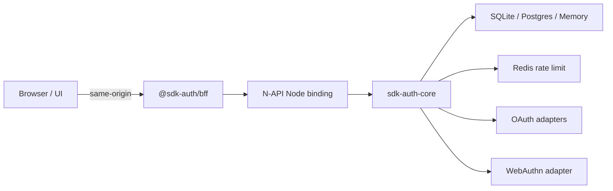

# SDK-Auth

<p align="center">
  <strong>English</strong> · <a href="README.pt-BR.md">Português (Brasil)</a>
</p>

<p align="center">
  
</p>

<p align="center">
  <a href="LICENSE-MIT"></a>
  <a href="rust-toolchain.toml"></a>
  <a href="package.json"></a>
  
</p>

Modular authentication SDK with a **Rust core** and adapters for Memory, SQLite, PostgreSQL, Redis, OAuth/OIDC, WebAuthn, Node.js (N-API), WebAssembly, plus a **token-blind TypeScript BFF**, browser client, and Lit/React login UI.

Stable private line: `0.6.0`. Active development: `0.7.0-alpha`. Crates remain `publish = false` until independent API and security review. TypeScript packages ship as workspace alphas and are **not** approved for production-critical use yet.

## Why SDK-Auth

- **Auth rules live in Rust** — composition roots stay thin; storage adapters share one contract.
- **Browser never sees SDK bearers** — access/refresh, OAuth, MFA, and passkey ceremony state stay server-side behind a same-origin BFF.
- **Hard defaults** — opaque tokens, Argon2id, realm isolation, exact RBAC, fail-closed rate limits, encrypted MFA vault, production BFF seals with AES-256-GCM.

## Architecture



Details: [Architecture](docs/ARCHITECTURE.md) · [Threat model](docs/THREAT_MODEL.md) · [BFF OpenAPI](docs/openapi/bff.yaml)

## Features

| Area | Highlights |
|------|------------|
| Identity | Register, email verify, login/logout, password reset, realms |
| Sessions | Opaque access + rotating refresh, remember-me, replay detection |
| MFA | TOTP (RFC 6238), recovery codes, trusted devices, sealed vault |
| Passkeys | WebAuthn UV required, server-side ceremony, exact origins |
| Federation | Google, GitHub, Microsoft (personal / Entra) with PKCE S256 |
| AuthZ | Exact RBAC, API keys with scopes, service accounts, IAM bootstrap |
| Scale | PostgreSQL multi-instance, Redis rate limit, outbox lease workers |
| Frontend | `@sdk-auth/browser` + `@sdk-auth/ui` (Web Components / React) |

## Quick start

**Requirements:** Rust ≥ 1.94 (toolchain pin in `rust-toolchain.toml`), Node.js ≥ 22, OpenSSL 3 dev libs for WebAuthn/Node full builds.

```bash
git clone https://github.com/Ssw0rDd/Auth-Sdk.git
cd Auth-Sdk
cp .env.example .env   # fill secrets locally — never commit .env
cargo test             # portable default workspace members
npm install
npm run bff:test && npm run browser:test && npm run ui:test
```

Full walkthrough: **[Getting started](docs/GETTING_STARTED.md)** · env vars: **[Configuration](docs/CONFIGURATION.md)** · day-to-day: **[Local development](docs/LOCAL_DEVELOPMENT.md)**

### Minimal Rust compose (in-memory)

```rust,no_run
use std::sync::Arc;
use sdk_auth_core::{AuthConfig, SdkAuth};
use sdk_auth_crypto::{
    Argon2PasswordEngine, OsTokenGenerator, SoftwareCryptoProvider, VaultKey, XChaCha20Vault,
};
use sdk_auth_memory::MemoryAuthStore;
use sdk_auth_types::SecretBytes;

# fn build(key_material: Vec<u8>) -> Result<(), Box<dyn std::error::Error>> {
let vault = XChaCha20Vault::new(
    "auth-v1",
    vec![VaultKey::new("auth-v1", SecretBytes::new(key_material))?],
)?;
let crypto = SoftwareCryptoProvider::new(
    Arc::new(Argon2PasswordEngine::recommended()?),
    Arc::new(OsTokenGenerator),
    Arc::new(vault),
);
let sdk = SdkAuth::builder()
    .store(Arc::new(MemoryAuthStore::new()))
    .crypto_provider(Arc::new(crypto))
    .auth_config(AuthConfig::default())
    .build()?;
# let _ = sdk;
# Ok(())
# }
```

Provide a **host-owned 32-byte vault key**. Never persist that key in the database.

### Browser + UI (token-blind)

```ts
import { BrowserAuthClient } from '@sdk-auth/browser'
import { connectAuthChallenge, connectAuthLogin } from '@sdk-auth/ui'
import '@sdk-auth/ui'
import '@sdk-auth/ui/theme.css'

const client = new BrowserAuthClient()
const login = document.querySelector('sdk-auth-login')
if (login) {
  login.showPasskey = true
  connectAuthLogin(login, client, {
    onAuthenticated: () => location.assign('/account'),
    onSecondFactorRequired: ({ methods }) => {
      const challenge = document.querySelector('sdk-auth-challenge')
      if (challenge) challenge.methods = methods
    },
  })
}
```

```html
<sdk-auth-login show-passkey>
  <a slot="forgot-password" href="/recover">Forgot password</a>
  <a slot="register" href="/register">Create account</a>
</sdk-auth-login>
<sdk-auth-challenge></sdk-auth-challenge>
```

Production BFF stores must use `@sdk-auth/bff/stores` (`createEncryptedBffStores`) over a truly distributed atomic KV. In-memory stores are single-process / test only.

## Documentation

| Guide | Description |
|-------|-------------|
| [Getting started](docs/GETTING_STARTED.md) | Prerequisites, clone, first build |
| [Configuration](docs/CONFIGURATION.md) | `.env.example`, vault/BFF keys, OAuth, cookies |
| [Local development](docs/LOCAL_DEVELOPMENT.md) | npm scripts, tests, Postgres/Redis, pentest |
| [Contributing](CONTRIBUTING.md) | Quality gates and PR expectations |
| [Node + TypeScript integration](docs/integrations/node-typescript.md) | Recommended 0.7 stack |
| [Browser + React](docs/integrations/browser-react.md) | Frontend wiring |
| [Other languages](docs/integrations/other-languages.md) | Sidecar / proxy hosts |
| [Migration 0.6 → 0.7](docs/MIGRATION-0.7.md) | Schema and ops migration |
| [Architecture & audits](docs/) | ADR, threat model, version audits |
| [Security policy](SECURITY.md) | Vulnerability reporting |
| [Roadmap](ROADMAP.md) | Release track |
| [Changelog](CHANGELOG.md) | Released changes |

## Security notes

- Tokens and API keys are secrets; they do not appear in `Debug`.
- Web apps: TLS, `HttpOnly` + `Secure` + `SameSite` cookies, CSRF on BFF mutations.
- Host owns CORS, CSP, trusted proxies, global rate limits, email delivery, backups, SIEM, and resource-level authorization (prevent IDOR).
- OAuth `CLIENT_SECRET` and vault/BFF keys are **server-only** — never `VITE_*` or client bundles.

Report vulnerabilities privately — see [SECURITY.md](SECURITY.md). Do not open public issues for security flaws.

## License

Your code: **MIT OR Apache-2.0**, at your option. The WebAuthn adapter pulls in MPL-2.0; see [THIRD_PARTY_LICENSES.md](THIRD_PARTY_LICENSES.md).
