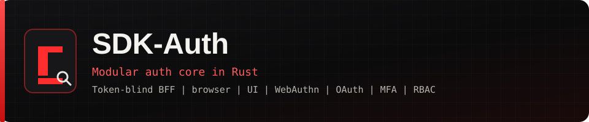
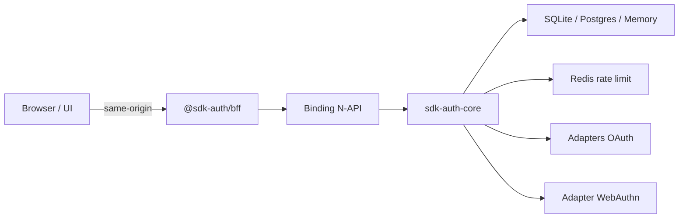

# SDK-Auth

<p align="center">
  <a href="README.md">English</a> · <strong>Português (Brasil)</strong>
</p>

<p align="center">
  
</p>

<p align="center">
  <a href="LICENSE-MIT"></a>
  <a href="rust-toolchain.toml"></a>
  <a href="package.json"></a>
  
</p>

SDK de autenticação modular com **Core em Rust** e adapters para Memory, SQLite, PostgreSQL, Redis, OAuth/OIDC, WebAuthn, Node.js (N-API), WebAssembly, além de **BFF token-blind em TypeScript**, cliente browser e UI Lit/React.

Linha estável privada: `0.6.0`. Desenvolvimento ativo: `0.7.0-alpha`. Os crates seguem com `publish = false` até revisão independente da API e da segurança. Os pacotes TypeScript são alphas de workspace e **ainda não** estão aprovados para uso crítico em produção.

## Por que SDK-Auth

- **Regras de auth no Rust** — roots de composição finos; adapters de storage com contrato comum.
- **Browser sem bearers do SDK** — access/refresh, OAuth, MFA e cerimônia de passkey ficam no servidor, atrás de BFF same-origin.
- **Defaults rígidos** — tokens opacos, Argon2id, isolamento por realm, RBAC exato, rate limit fail-closed, vault MFA criptografado, BFF de produção com AES-256-GCM.

## Arquitetura



Detalhes: [Arquitetura](docs/ARCHITECTURE.md) · [Modelo de ameaças](docs/THREAT_MODEL.md) · [OpenAPI do BFF](docs/openapi/bff.yaml)

## Recursos

| Área | Destaques |
|------|-----------|
| Identidade | Registro, verificação de e-mail, login/logout, reset de senha, realms |
| Sessões | Access opaco + refresh com rotação, remember-me, detecção de replay |
| MFA | TOTP (RFC 6238), recovery codes, dispositivos confiáveis, vault selado |
| Passkeys | WebAuthn com UV, cerimônia server-side, origens exatas |
| Federação | Google, GitHub, Microsoft (pessoal / Entra) com PKCE S256 |
| AuthZ | RBAC exato, API keys com scopes, contas de serviço, bootstrap IAM |
| Escala | PostgreSQL multi-instância, Redis rate limit, outbox com lease |
| Frontend | `@sdk-auth/browser` + `@sdk-auth/ui` (Web Components / React) |

## Início rápido

**Requisitos:** Rust ≥ 1.94 (pin em `rust-toolchain.toml`), Node.js ≥ 22, bibliotecas de desenvolvimento do OpenSSL 3 para builds completos com WebAuthn/Node.

```bash
git clone https://github.com/Ssw0rDd/Auth-Sdk.git
cd Auth-Sdk
cp .env.example .env   # preencha localmente — nunca faça commit do .env
cargo test             # membros portáteis do workspace padrão
npm install
npm run bff:test && npm run browser:test && npm run ui:test
```

Guia completo: **[Getting started](docs/GETTING_STARTED.md)** · variáveis: **[Configuration](docs/CONFIGURATION.md)** · dia a dia: **[Local development](docs/LOCAL_DEVELOPMENT.md)**

### Compose mínimo em Rust (memória)

```rust,no_run
use std::sync::Arc;
use sdk_auth_core::{AuthConfig, SdkAuth};
use sdk_auth_crypto::{
    Argon2PasswordEngine, OsTokenGenerator, SoftwareCryptoProvider, VaultKey, XChaCha20Vault,
};
use sdk_auth_memory::MemoryAuthStore;
use sdk_auth_types::SecretBytes;

# fn build(key_material: Vec<u8>) -> Result<(), Box<dyn std::error::Error>> {
let vault = XChaCha20Vault::new(
    "auth-v1",
    vec![VaultKey::new("auth-v1", SecretBytes::new(key_material))?],
)?;
let crypto = SoftwareCryptoProvider::new(
    Arc::new(Argon2PasswordEngine::recommended()?),
    Arc::new(OsTokenGenerator),
    Arc::new(vault),
);
let sdk = SdkAuth::builder()
    .store(Arc::new(MemoryAuthStore::new()))
    .crypto_provider(Arc::new(crypto))
    .auth_config(AuthConfig::default())
    .build()?;
# let _ = sdk;
# Ok(())
# }
```

Forneça uma **chave de vault de 32 bytes gerida pelo host**. Nunca grave essa chave no banco.

### Browser + UI (token-blind)

```ts
import { BrowserAuthClient } from '@sdk-auth/browser'
import { connectAuthChallenge, connectAuthLogin } from '@sdk-auth/ui'
import '@sdk-auth/ui'
import '@sdk-auth/ui/theme.css'

const client = new BrowserAuthClient()
const login = document.querySelector('sdk-auth-login')
if (login) {
  login.showPasskey = true
  connectAuthLogin(login, client, {
    onAuthenticated: () => location.assign('/account'),
    onSecondFactorRequired: ({ methods }) => {
      const challenge = document.querySelector('sdk-auth-challenge')
      if (challenge) challenge.methods = methods
    },
  })
}
```

```html
<sdk-auth-login show-passkey>
  <a slot="forgot-password" href="/recover">Esqueci a senha</a>
  <a slot="register" href="/register">Criar conta</a>
</sdk-auth-login>
<sdk-auth-challenge></sdk-auth-challenge>
```

Em produção, use `@sdk-auth/bff/stores` (`createEncryptedBffStores`) sobre um KV distribuído e atômico. Stores em memória são só para testes/processo único.

## Documentação

| Guia | Descrição |
|------|-----------|
| [Getting started](docs/GETTING_STARTED.md) | Pré-requisitos, clone, primeiro build |
| [Configuration](docs/CONFIGURATION.md) | `.env.example`, chaves vault/BFF, OAuth, cookies |
| [Local development](docs/LOCAL_DEVELOPMENT.md) | Scripts npm, testes, Postgres/Redis, pentest |
| [Contributing](CONTRIBUTING.md) | Quality gates e expectativas de PR |
| [Integração Node + TypeScript](docs/integrations/node-typescript.md) | Stack recomendada 0.7 |
| [Browser + React](docs/integrations/browser-react.md) | Wiring do frontend |
| [Outras linguagens](docs/integrations/other-languages.md) | Host sidecar / proxy |
| [Migração 0.6 → 0.7](docs/MIGRATION-0.7.md) | Schema e operações |
| [Arquitetura e auditorias](docs/) | ADR, threat model, audits por versão |
| [Política de segurança](SECURITY.md) | Relato de vulnerabilidades |
| [Roadmap](ROADMAP.md) | Linha de releases |
| [Changelog](CHANGELOG.md) | Mudanças publicadas |

## Notas de segurança

- Tokens e API keys são segredos; não aparecem em `Debug`.
- Apps web: TLS, cookies `HttpOnly` + `Secure` + `SameSite`, CSRF nas mutações do BFF.
- O host responde por CORS, CSP, proxies confiáveis, rate limit global, e-mail, backup, SIEM e autorização por recurso (anti-IDOR).
- `CLIENT_SECRET` OAuth e chaves vault/BFF são **somente servidor** — nunca `VITE_*` nem bundle do cliente.

Relate vulnerabilidades de forma privada — veja [SECURITY.md](SECURITY.md). Não abra issue pública para falhas de segurança.

## Licença

Código próprio: **MIT OU Apache-2.0**, à sua escolha. O adapter WebAuthn usa dependência MPL-2.0; consulte [THIRD_PARTY_LICENSES.md](THIRD_PARTY_LICENSES.md).
