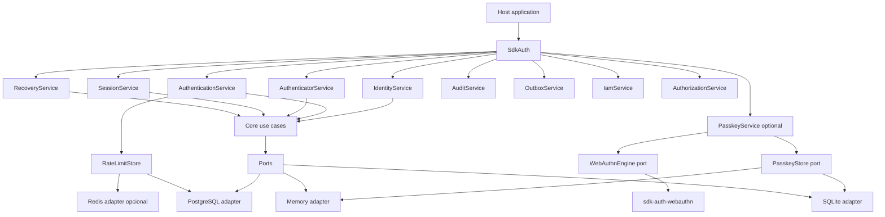
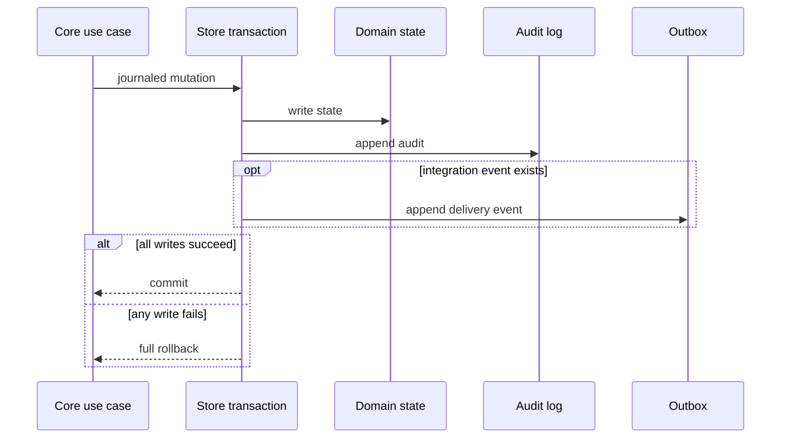
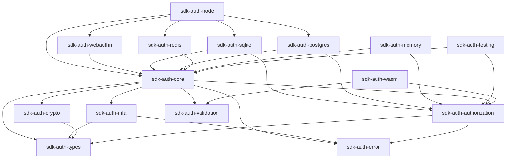
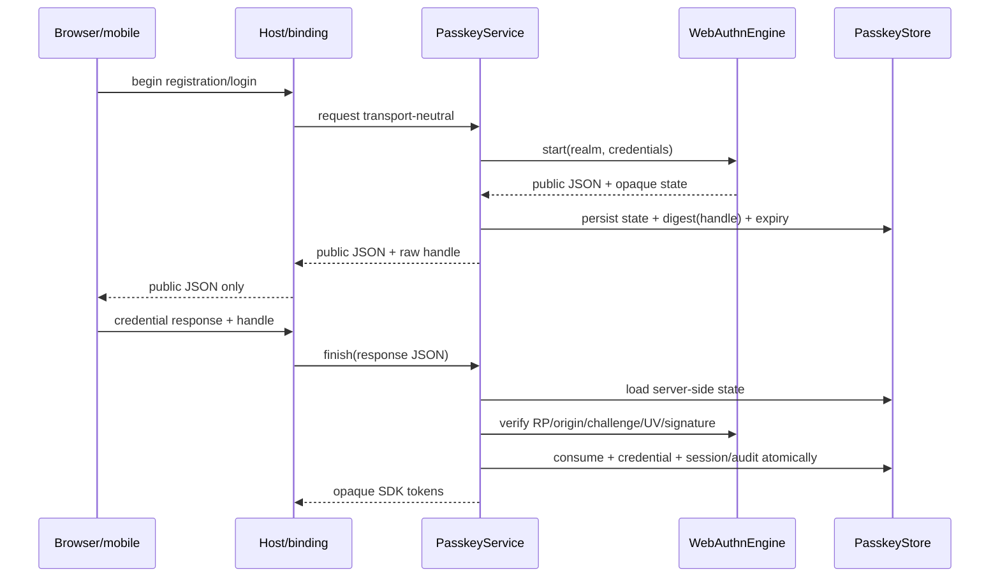
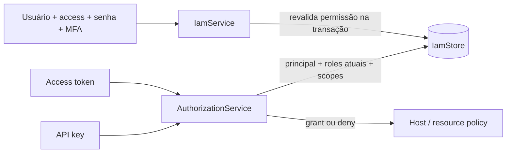
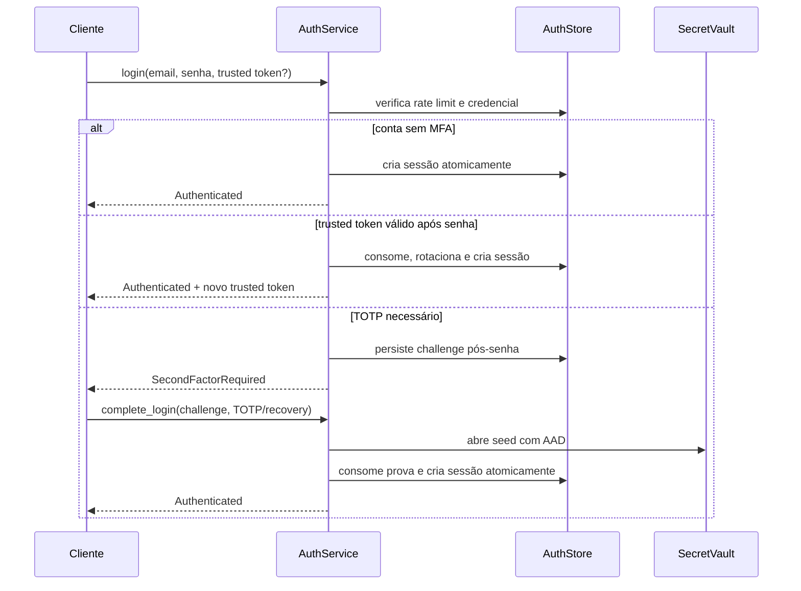
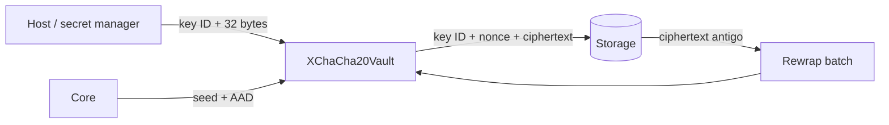
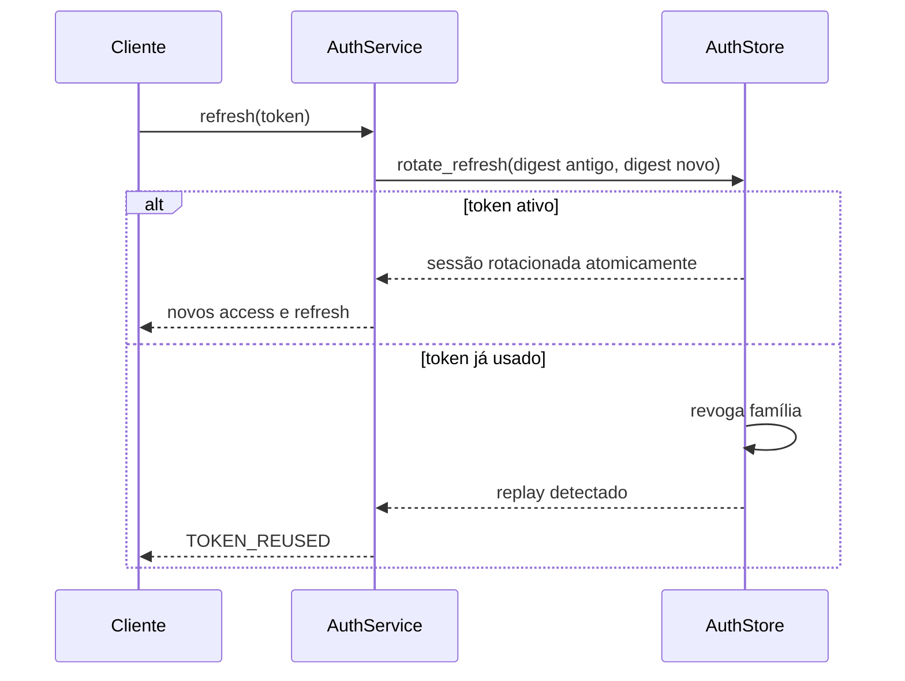
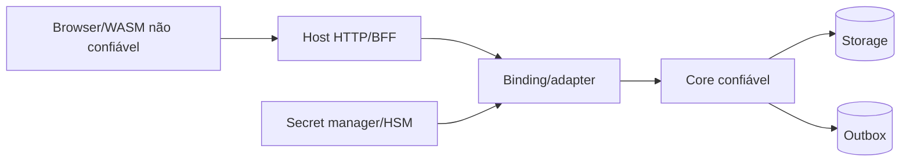
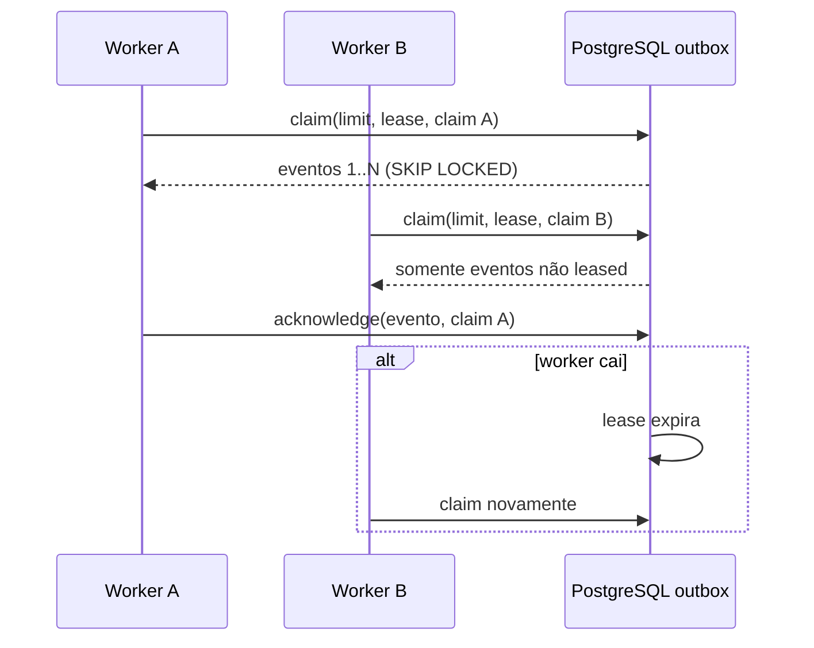

# Arquitetura

## Portabilidade do workspace 0.7

O conjunto padrão da raiz contém os crates portáveis e é testado sem dependências
nativas em Windows, Linux e macOS. `sdk-auth-webauthn` permanece um adapter
opcional porque a API segura de `webauthn-rs` exige OpenSSL; `sdk-auth-node`
compõe esse adapter e precisa ser publicado por prebuilds, nunca exigindo que o
consumidor final compile OpenSSL. `--workspace` continua sendo o gate completo.
Veja o ADR 0007.

## Composition root 0.6

As facades limitam a superfície descoberta por cada consumidor. Durante a janela
0.x, `AuthService` continua como implementação interna de compatibilidade para o
binding Node, mas não é a API recomendada para integrações novas.

## Unit of Work e journal

`SdkStore` exige `UnitOfWorkStore::REQUIRED`. Em PostgreSQL, a garantia usa uma
transação SQL e locks de linha/realm; em SQLite, transação `IMMEDIATE`; em Memory,
uma única seção crítica serializa as três gravações.
Audit é append-only e não compartilha acknowledgement ou retenção com o outbox.
Login, verificação de e-mail e revogação de sessão geram audit sem gerar evento
de integração; notificações e alterações IAM podem gravar ambos.

## Assurance e criptografia versionada

`Session::assurance()` deriva um resultado conservador da evidência persistida.
Password é AAL1; password com TOTP ou recovery code é AAL2 sem phishing
resistance; trusted-device permanece AAL1 porque o Core não controla o storage
do host. Passkey UV-required é AAL2, phishing-resistant e user-verified dentro
do modelo conservador da SDK; AAL3 nunca é inferido sem hardware e attestation
verificáveis.

`CryptoProvider` compõe password hashing, CSPRNG e vault. Ciphertexts persistem
`format_version`, `algorithm`, `key_id`, nonce e ciphertext. Formato/algoritmo
desconhecido falha fechado. O provider software declara explicitamente
`fips_validated = false`.

## Dependências

O Core contém casos de uso e transições. Adapters dependem dele; o Core não
conhece SQLite, N-API, WebAssembly, HTTP ou framework. Traits de identidade,
sessão, challenge, rate limit, evento e MFA são segregadas e compostas por
`AuthStore`. `IamStore` isola catálogo, roles, assignments, service accounts e
API keys. `SdkStore` compõe ambos apenas no composition root `SdkAuth`.
`PasskeyStore` é uma capability opcional composta separadamente, preservando
adapters que implementam apenas autenticação e IAM.

## WebAuthn/passkeys

O adapter concreto serializa estado e credencial com `provider_id` e versão. O
estado permanece exclusivamente server-side, indexado por handle aleatório de
256 bits persistido apenas como digest. Registro é ligado ao mesmo realm,
usuário e sessão do início. Credential IDs são únicos globalmente.

O RP ID é imutável por realm. A allow-list aceita origem HTTPS exata e,
opcionalmente, identidade Android exata derivada do certificado de assinatura.
Subdomínios e portas arbitrárias permanecem desativados.

Counter positivo precisa aumentar atomicamente. Regressão ou repetição positiva
consome a cerimônia, revoga a passkey, grava audit denied e não cria sessão.
Counter zero de passkeys sincronizadas não é tratado como clone.

## IAM e autorização

O bootstrap cria uma única role `realm_owner` e o catálogo IAM mínimo. Não há
wildcards, hierarquia, explicit deny ou ABAC em 0.3. A decisão é exata,
deny-by-default e reavaliada em cada chamada. API keys só chegam ao data plane;
o control plane aceita exclusivamente usuário humano com step-up fresco.

O `AuthorizationGrant` comprova apenas a permissão genérica solicitada. Ownership,
tenant do recurso e regras contra IDOR continuam no Core de domínio do host.

## Login com MFA

Não existe sessão parcial entre senha e MFA. Counters TOTP, recovery codes,
challenges e tokens de trusted device são consumidos na mesma transação que cria
a sessão.

## Vault e rotação de chaves

AAD inclui realm, usuário e identificador do fator/enrollment. O banco nunca
recebe seed ou recovery code em texto. Chaves antigas permanecem apenas durante
a janela de rewrap; remoção prematura torna ciphertext antigo irrecuperável.

## Refresh token

## Fronteiras

WASM expõe somente validação client-side. Password hashing, tokens, sessões,
TOTP, recovery codes, API keys e key material continuam server-side. O parser
WASM nunca substitui a decisão server-side.

Email serve somente para ownership e recuperação. Link recebido por email não
cria sessão, não satisfaz MFA e não autoriza gestão de passkeys.

## SQLite

`SqliteMigrator` é executado separadamente. `SqliteAuthStore::open` valida
`PRAGMA user_version` e recusa drift. Transições de replay, rotação, ativação e
revogação usam transações `IMMEDIATE`. O schema v6 adiciona rate limit sliding e
leases de outbox. Bootstrap e mutações IAM revalidam a
permissão do ator na mesma transação. SQLite é indicado para instância única ou
baixo write contention; escala horizontal exige outro adapter.

## PostgreSQL, Redis e outbox distribuído

PostgreSQL 16–18 é o store distribuído oficial. O pool é limitado, possui
timeouts de acquire/connect/statement/lock/transação ociosa e TLS `verify-full`
por padrão. Migrações são explícitas, checksummed e protegidas por advisory lock.
O startup valida versão, conjunto mínimo de tabelas e estado de importação.

O outbox usa `FOR UPDATE SKIP LOCKED`, claim opaco e lease entre 5 segundos e 15
minutos. A semântica é at-least-once: consumidores devem ser idempotentes. Ack
sem claim, claim incorreto ou expirado não entrega o evento.

Redis 7/8 implementa somente rate limiting. Um script Lua atômico mantém janela
sliding exata e lockout para buckets independentes de conta e rede. Chaves usam
BLAKE3 keyed com segredo do host. Falha Redis nega a tentativa; não há fallback
local que permita bypass entre réplicas. Topologias Cluster/Sentinel e réplica
de leitura não fazem parte do contrato 0.6.

## Migração SQLite → PostgreSQL

A ferramenta `sdk-auth-migrate` exige SQLite v6 íntegro, adquire lock que impede
novos escritores e aceita somente PostgreSQL vazio. `sdk_import_status` é gravado
antes da cópia; todas as tabelas são convertidas e inseridas em uma transação.
Crash ou erro deixa status não completo e `PostgresAuthStore::connect` falha
fechado. Migração online/dual-write foi rejeitada nesta fase.
